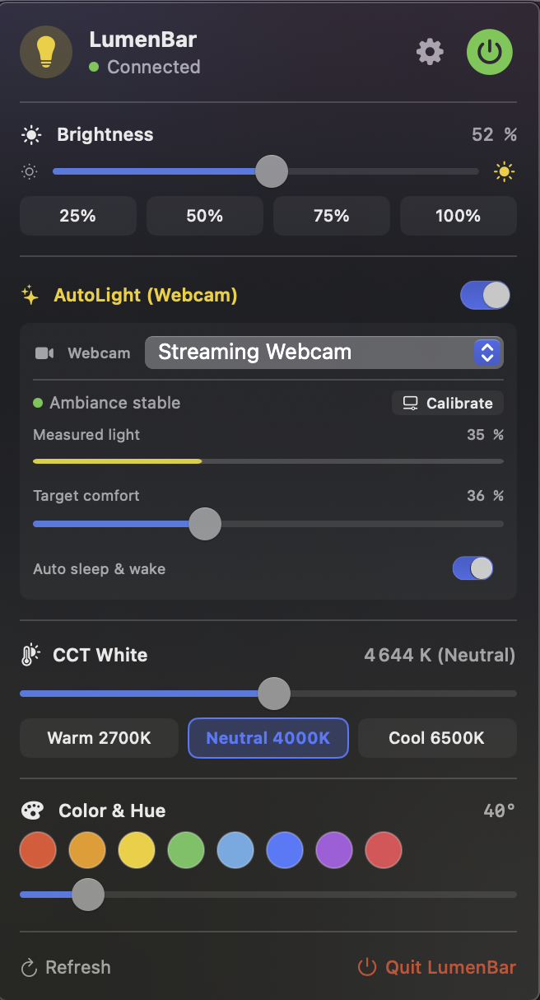

# LumenBar

> **Contrôleur Bluetooth Low Energy (BLE) direct et applications natives macOS (Barre des menus) & Android pour luminaires connectés (Inspire / Lexman / GATT).**

**Français** | [English](README.md)

[](https://apple.com)
[-3DDC84.svg?style=flat&logo=android&logoColor=white)](https://android.com)
[](https://swift.org)
[](https://kotlinlang.org)
[](https://python.org)
[](LICENSE)

LumenBar permet de piloter instantanément et localement en direct (sans pont Zigbee, sans passerelle Cloud, sans hub externe) les luminaires connectés commercialisés sous les marques **Inspire** et **Lexman** (groupe Adeo / Leroy Merlin, notamment le plafonnier LED *Inspire Gdansk* `ZBEK-27`) ainsi que tout équipement exploitant le service GATT propriétaire `0000a101-1115-1000-0001-617573746f6d`.

<p align="center">
  
</p>

---

## Fonctionnalités

* 🚀 **Latence ultra-faible (< 30 ms)** : Démon d'arrière-plan maintenant une liaison BLE CoreBluetooth persistante et communiquant par socket UNIX avec l'interface.
* 🖥️ **Application macOS Menu Bar native** : Développée en Swift & SwiftUI (`LSUIElement`), discrète dans la barre des menus, sans fenêtre flottante superflue.
* 📱 **Application Android native** : Développée en Kotlin avec Material Components 3, contrôle BLE GATT direct et réactif, gestion du capteur de lumière ambiante, sans compte, sans cloud ni service tiers.
* 🌐 **Bilingue Français & Anglais** : Détection automatique de la langue système macOS et sélecteur manuel dans les préférences.
* 💡 **Gradateur & Allumage** : Contrôle continu de luminosité de 0% à 100% avec boutons de présélection instantanée (25%, 50%, 75%, 100%).
* 👁️ **Régulation AutoLight en Boucle Fermée (Daylight Harvesting)** : Asservissement inspiré des standards LBNL / IES régulant la luminosité totale perçue vers une consigne de confort.
* 🔒 **Verrouillage de l'exposition webcam** : Blocage matériel de l'AEC/AGC (`AVCaptureExposureMode.locked`) pour éliminer le paradoxe d'amplification automatique du capteur vidéo.
* 🎯 **Étalonnage différentiel 3 points & Low-End Trim** : Mesure du fond ambiant ($S_{\text{off}}$), de l'émission plancher à 1% ($\Delta S_{\text{min}}$) et du gain optique ($S_{80}$ à 80%) pour éliminer tout effet de pompage (*hunting*) à basse puissance.
* 📉 **Rampe ultra-douce** : Variations limitées à 1% par cycle (1.8s) pour des transitions imperceptibles pour les yeux.
* 🌙 **Veille & Réveil automatique** : Extinction complète quand la lumière du jour suffit, et rallumage progressif dès que la pièce s'assombrit (avec hystérésis anti-oscillation).
* 📹 **Sélecteur de webcam** : Détection dynamique et bascule à chaud entre caméras physiques et virtuelles (Continuity, OBS, etc.).
* 🌡️ **Blanc variable CCT (2700K - 6500K)** : Régulation continue de la température de couleur (Chaud, Neutre, Froid).
* 🎨 **Roue Chromatique 360°** : Prise en charge de la sélection de teinte exacte ou via palette de nuances directes.
* 🔍 **Découverte & Appairage intégrés** : Scanner Bluetooth intégré dans l'application pour détecter, associer ou dissocier un luminaire en un clic.
* 🔌 **Arrêt propre & Éco-énergie** : Extinction automatique de l'éclairage et fermeture propre de la session BLE à la fermeture de l'application.

---

## Architecture

```
┌────────────────────────────────────────────────────────┐
│      LumenBar.app (SwiftUI & AppKit MenuBarExtra)      │
│      • Interface barre des menus (bilingue FR/EN)      │
│      • Moteur AutoLight (AVFoundation + boucle fermée) │
│      • Gestionnaire de périphériques & Appairage BLE   │
└───────────────────────────┬────────────────────────────┘
                            │ Socket UNIX (/tmp/lumenbar.sock)
                            ▼
┌────────────────────────────────────────────────────────┐
│      Démon Python BLE (`lumenbar.py _daemon_worker`)   │
│      • Maintient la connexion CoreBluetooth (Bleak)    │
│      • Traite les requêtes asynchrones en continu      │
│      • Reçoit et décode les notifications de la lampe  │
└───────────────────────────┬────────────────────────────┘
                            │ Bluetooth LE GATT
                            ▼
┌────────────────────────────────────────────────────────┐
│      Luminaire Connecté (Inspire / Lexman / ZBEK-27)   │
└───────────────────────────┬────────────────────────────┘
```

---

## Régulation AutoLight (Daylight Harvesting)

### Le Problème du Capteur Vidéo
Lorsqu'une webcam observe un espace de travail éclairé par une source artificielle régulée, deux phénomènes physiques perturbent les asservissements classiques :
1. **L'Auto-Exposition de la caméra (AEC/AGC)** : Quand la lampe faiblit, l'algorithme d'exposition de la caméra augmente le gain du capteur. La luminance moyenne brute mesurée reste alors constante, ce qui fausse toute estimation découplée simple ($L_{\text{brut}} - \alpha B$).
2. **Le Plancher d'Émission Minimale (Low-End Trim)** : De nombreux panneaux LED (dont la gamme Inspire/Lexman) émettent un flux lumineux significatif dès leur seuil minimal de 1%. Si le régulateur allume la lampe pour combler un faible déficit lumineux, l'apport dépasse instantanément la consigne, provoquant une extinction immédiate (effet d'oscillation continue / *hunting*).

### La Solution LumenBar
1. **Verrouillage matériel d'exposition** : Dès l'activation d'AutoLight ou de l'étalonnage, l'exposition et le gain de la webcam sont verrouillés (`AVCaptureExposureMode.locked`). La réponse du capteur redevient strictement proportionnelle au flux lumineux réel.
2. **Échantillonnage passif & confidentiel** : Prélèvement d'une miniature en RAM toutes les 1.8s via `AVFoundation`. Aucune image n'est enregistrée sur disque ni transmise sur le réseau.
3. **Étalonnage différentiel 3 points** :
   - Échelon 1 (Lampe éteinte) : mesure de la lumière ambiante de fond $S_{\text{off}}$.
   - Échelon 2 (Lampe à 1%) : mesure de l'émission minimale $\Delta S_{\text{min}} = S_{1} - S_{\text{off}}$.
   - Échelon 3 (Lampe à 80%) : calcul du gain optique différentiel $G = \frac{S_{80} - S_{\text{off}}}{80}$.
4. **Asservissement en boucle fermée (Closed-Loop Error Regulation)** :
   $$\Delta B = \frac{\eta}{G} \cdot (S_{\text{cible}} - S(t))$$
   avec un facteur de gain amorti $\eta = 0.40$ et une bande morte de $\pm 1.5$%.
5. **Hystérésis d'allumage basée sur le Low-End Trim** : Quand la lampe est éteinte, elle ne se rallume que si le déficit mesuré est suffisant pour absorber le flux minimal de 1% ($S_{\text{cible}} - S(t) \ge \Delta S_{\text{min}} \times 0.85$), éliminant tout pompage.
6. **Rampe de variation ultra-douce** : L'ajustement est limité à $\le 1$% par cycle (1.8s), rendant l'adaptation lumineuse totalement imperceptible pour l'utilisateur au travail.

---

## Protocole GATT & Trames Hexadécimales

* **UUID d'écriture (Write with response)** : `0000a101-1115-1000-0001-617573746f6d`
* **UUID de lecture / notifications** : `0000a102-1115-1000-0001-617573746f6d`

### Format des Trames de Commande

Chaque trame commence par le préfixe `00 00` suivi de l'identifiant de fonction (opcode), de la longueur utile et de la valeur :

| Fonction | Opcode | Trame Hexadécimale | Plage / Description |
| :--- | :---: | :--- | :--- |
| **Allumage (ON)** | `0x10` | `0000100103010000` | Allume le luminaire |
| **Extinction (OFF)**| `0x10` | `0000100103000000` | Éteint le luminaire |
| **Luminosité (Dim)**| `0x11` | `0000110103[VAL]0000` | `[VAL]` de `0x00` (0%) à `0xFE` (100%) |
| **Blanc CCT** | `0x12` | `0000120104[B1][B0]0000` | Valeur 16-bit Mireds (`0x0099` = 6500K à `0x01C6` = 2700K) |
| **Teinte (Hue)** | `0x13` | `0000130103[VAL]0000` | Angle 0°–360° proportionnel sur `0x00` à `0xFE` |

### Interrogation d'État
* `00001002` : Lecture de l'état d'alimentation
* `00001102` : Lecture du niveau de luminosité
* `00001202` : Lecture de la température CCT
* `00001302` : Lecture de la teinte de couleur

---

## Utilisation en Ligne de Commande (CLI)

Le script Python [Resources/lumenbar.py](file:///Users/yoto/LumenBar/Resources/lumenbar.py) peut être utilisé directement en ligne de commande :

```bash
# Rechercher les luminaires compatibles
python3 Resources/lumenbar.py scan

# Allumer / Éteindre
python3 Resources/lumenbar.py on
python3 Resources/lumenbar.py off

# Régler la luminosité (0 à 100 %)
python3 Resources/lumenbar.py dim 60

# Régler la température de blanc (2700 à 6500 K)
python3 Resources/lumenbar.py temp 4000

# Régler la couleur (nom ou degré 0-360)
python3 Resources/lumenbar.py color blue
python3 Resources/lumenbar.py hue 210

# Consulter l'état complet
python3 Resources/lumenbar.py status
```

---

## Compilation & Installation de l'Application macOS

L'application ne nécessite pas l'installation complète de Xcode : les Command Line Tools (`swiftc`) suffisent :

```bash
./build.sh
```

Le script compile les sources Swift et installe l'application signée ad-hoc dans `~/Applications/LumenBar.app`.

---

## Compilation & Installation de l'Application Android (APK)

L'application Android se compile en ligne de commande via Gradle :

```bash
./android/build-apk.sh
```

Le script produit un APK signé pour le sideload direct :
* `LumenBar.apk` (à la racine du projet et dans `android/`)

Un hook optionnel `android/post-build.local.sh` (ignoré par Git) peut être configuré pour automatiser la distribution (par exemple via Telegram ou `adb install`).

---

## Licence

Projet open source publié sous licence [MIT](LICENSE).
