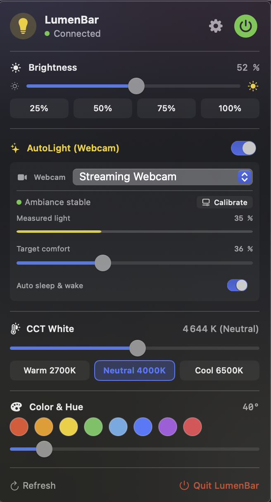

# LumenBar

> **Direct Bluetooth Low Energy (BLE) controller and native macOS menu bar app for smart fixtures (Inspire / Lexman / GATT).**

**English** | [Français](README.fr.md)

[](https://apple.com)
[](https://swift.org)
[](https://python.org)
[](LICENSE)

LumenBar provides instant, direct local control (no Zigbee bridge, no cloud gateway, no external hub) for smart light fixtures sold under the **Inspire** and **Lexman** brands (Adeo / Leroy Merlin group, notably the *Inspire Gdansk* `ZBEK-27` LED ceiling panel) as well as any device implementing the proprietary GATT service `0000a101-1115-1000-0001-617573746f6d`.

<p align="center">
  
</p>

---

## Features

* 🚀 **Ultra-low latency (< 30 ms)**: Background daemon maintaining a persistent CoreBluetooth link and communicating via UNIX domain socket.
* 🖥️ **Native macOS Menu Bar App**: Built with Swift & SwiftUI (`LSUIElement`), unobtrusive in the status bar with no lingering windows.
* 🌐 **Bilingual (English & French)**: Automatic macOS system language detection with in-app manual preference override.
* 💡 **Dimming & Power**: Continuous brightness control from 0% to 100% with one-click quick presets (25%, 50%, 75%, 100%).
* 👁️ **Closed-Loop AutoLight (Daylight Harvesting)**: Proportional closed-loop regulation based on standard LBNL / IES daylight harvesting principles, steering total desk illuminance toward your target comfort level.
* 🔒 **Webcam Exposure Locking**: Hardware locking of camera AEC/AGC (`AVCaptureExposureMode.locked`) to prevent webcam auto-gain compensation from distorting ambient light readings.
* 🎯 **3-Point Differential Calibration & Low-End Trim**: Calibrates ambient baseline ($S_{\text{off}}$), minimum physical output at 1% ($\Delta S_{\text{min}}$), and optical gain slope ($S_{80}$ at 80%) to prevent hunting at low brightness.
* 📉 **Ultra-smooth slew rate**: Ramp rate capped at $\le 1$% per 1.8s cycle for imperceptible lighting transitions.
* 🌙 **Automatic Sleep & Wake**: Gracefully dims and turns off the lamp when natural daylight meets the target setpoint, and wakes back up when room light dims (with anti-chatter hysteresis).
* 📹 **Webcam Selector**: Live detection and selection across physical and virtual cameras (Continuity Camera, OBS, etc.).
* 🌡️ **Tunable White CCT (2700K - 6500K)**: Continuous Kelvin / Mired temperature slider (Warm, Neutral, Cold).
* 🎨 **360° Color Wheel**: Direct hue picker and curated color swatches.
* 🔍 **Built-in Device Discovery & Pairing**: Integrated Bluetooth scanner to discover, pair, or unpair fixtures in one click.
* 🔌 **Graceful Shutdown**: Turns off light and terminates BLE connection cleanly on app quit.

---

## Architecture

```
┌────────────────────────────────────────────────────────┐
│      LumenBar.app (SwiftUI & AppKit MenuBarExtra)      │
│      • Menu bar popover interface (Bilingual EN/FR)    │
│      • AutoLight Engine (AVFoundation + closed loop)   │
│      • BLE Device Manager & Pairing                    │
└───────────────────────────┬────────────────────────────┘
                            │ UNIX Domain Socket (/tmp/lumenbar.sock)
                            ▼
┌────────────────────────────────────────────────────────┐
│      Python BLE Daemon (`lumenbar.py _daemon_worker`)  │
│      • Maintains CoreBluetooth link (Bleak)            │
│      • Processes continuous asynchronous requests      │
│      • Receives and decodes fixture notifications      │
└───────────────────────────┬────────────────────────────┘
                            │ Bluetooth LE GATT
                            ▼
┌────────────────────────────────────────────────────────┐
│      Smart Fixture (Inspire / Lexman / ZBEK-27)        │
└────────────────────────────────────────────────────────┘
```

---

## Closed-Loop AutoLight (Daylight Harvesting)

### The Webcam Sensor Challenge
When a camera monitors a workspace lit by an adjustable artificial light, two physical factors undermine simple control systems:
1. **Camera Auto-Exposure (AEC/AGC)**: As the lamp dims, the webcam sensor automatically boosts its analog and digital gain. The raw measured pixel luminance remains flat, creating an auto-exposure paradox where ambient light appears to rise as the lamp dims.
2. **Minimum Output Floor (Low-End Trim)**: Many LED panels (including Inspire/Lexman fixtures) emit noticeable luminous flux even at their lowest setting (1%). If a controller turns the lamp on for a tiny light deficit, the minimum step overshoots the setpoint, triggering an immediate shut-off and creating an endless on/off oscillation (*hunting*).

### The LumenBar Architecture
1. **Hardware Exposure Lock**: Whenever AutoLight or calibration runs, the webcam exposure duration and sensor ISO are locked (`AVCaptureExposureMode.locked`). Sensor response becomes strictly proportional to real photons on desk surfaces.
2. **Passive & Private Sampling**: A downsampled frame is processed in volatile RAM every 1.8 seconds via `AVFoundation`. No video or photographic data is ever written to disk or transmitted over the network.
3. **3-Point Differential Calibration**:
   - Step 1 (Lamp Off): Measures baseline ambient room illuminance $S_{\text{off}}$.
   - Step 2 (Lamp at 1%): Measures the minimum physical output floor $\Delta S_{\text{min}} = S_{1} - S_{\text{off}}$.
   - Step 3 (Lamp at 80%): Computes the differential optical gain slope $G = \frac{S_{80} - S_{\text{off}}}{80}$.
4. **Closed-Loop Error Regulation**:
   $$\Delta B = \frac{\eta}{G} \cdot (S_{\text{target}} - S(t))$$
   with damped gain $\eta = 0.40$ and an error deadband of $\pm 1.5$%.
5. **Low-End Trim Ignition Hysteresis**: When the lamp is off, it will only ignite if the daylight deficit is large enough to absorb the minimum 1% light output ($S_{\text{target}} - S(t) \ge \Delta S_{\text{min}} \times 0.85$), eliminating low-end hunting.
6. **Ultra-Smooth Slew Rate**: Luminance adjustments are capped at $\le 1$% per cycle (1.8s), making light adaptations entirely imperceptible to working eyes.

---

## GATT Protocol & Hexadecimal Frames

* **Write Characteristic (Write with response)**: `0000a101-1115-1000-0001-617573746f6d`
* **Read / Notification Characteristic**: `0000a102-1115-1000-0001-617573746f6d`

### Command Frame Structure

Each command starts with the prefix `00 00`, followed by the function identifier (opcode), data length, and payload:

| Function | Opcode | Hexadecimal Frame | Range / Description |
| :--- | :---: | :--- | :--- |
| **Power ON** | `0x10` | `0000100103010000` | Turns fixture ON |
| **Power OFF**| `0x10` | `0000100103000000` | Turns fixture OFF |
| **Brightness (Dim)**| `0x11` | `0000110103[VAL]0000` | `[VAL]` from `0x00` (0%) to `0xFE` (100%) |
| **White CCT** | `0x12` | `0000120104[B1][B0]0000` | 16-bit Mireds (`0x0099` = 6500K to `0x01C6` = 2700K) |
| **Hue** | `0x13` | `0000130103[VAL]0000` | Angle 0°–360° mapped linearly to `0x00`–`0xFE` |

### State Queries
* `00001002`: Query power state
* `00001102`: Query brightness level
* `00001202`: Query CCT temperature
* `00001302`: Query color hue

---

## Command-Line Interface (CLI)

The Python daemon script [Resources/lumenbar.py](file:///Users/yoto/LumenBar/Resources/lumenbar.py) can also be used directly from the terminal:

```bash
# Scan for compatible fixtures
python3 Resources/lumenbar.py scan

# Power ON / OFF
python3 Resources/lumenbar.py on
python3 Resources/lumenbar.py off

# Adjust brightness (0 to 100%)
python3 Resources/lumenbar.py dim 60

# Adjust white color temperature (2700 to 6500 K)
python3 Resources/lumenbar.py temp 4000

# Set color (name or hue angle 0-360)
python3 Resources/lumenbar.py color blue
python3 Resources/lumenbar.py hue 210

# Read current device status
python3 Resources/lumenbar.py status
```

---

## Building & Installing the macOS App

No full Xcode installation is required. macOS Command Line Tools (`swiftc`) are sufficient:

```bash
./build.sh
```

The script compiles the Swift sources and produces an ad-hoc signed app bundle in `~/Applications/LumenBar.app`.

---

## License

Open source project released under the [MIT](LICENSE) license.
